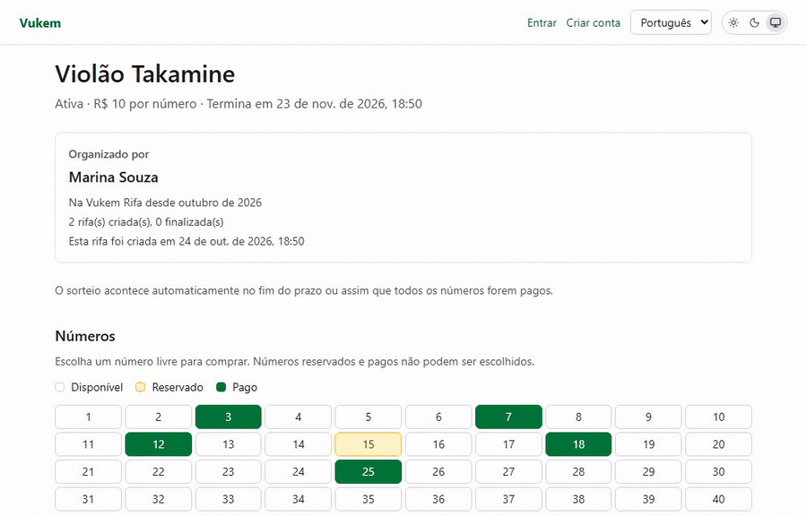
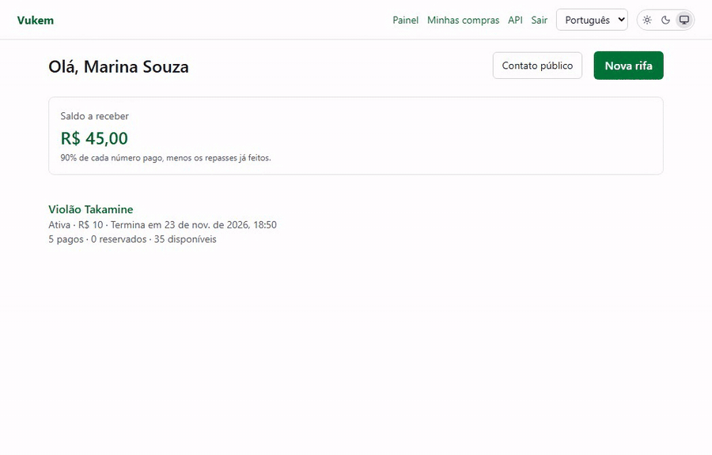
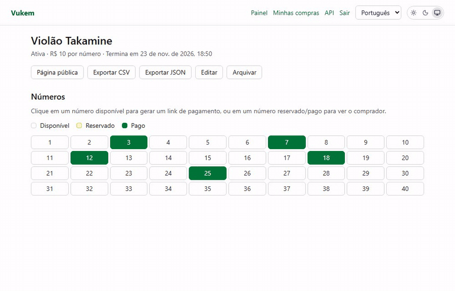
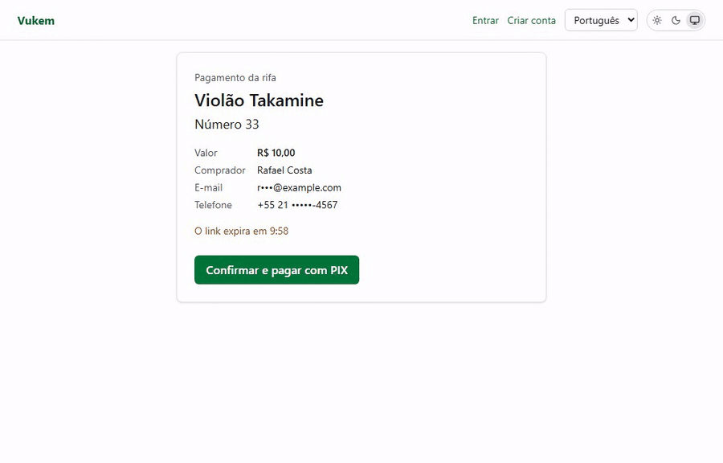
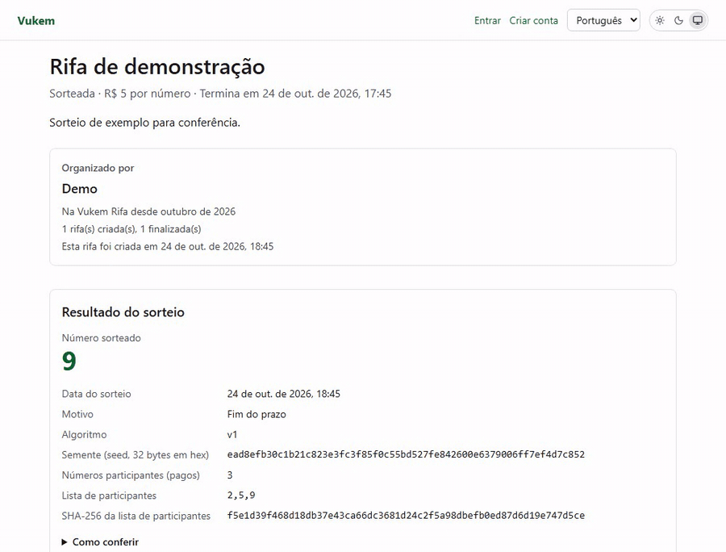
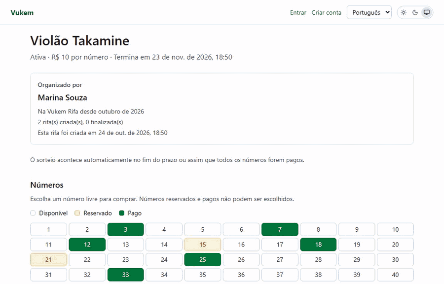

<h1 align="center">Vukem Rifa</h1>

<p align="center">
  <a href="https://github.com/AlexGalhardo/vukem-rifa-vuejs/actions/workflows/ci.yml"></a>
  <a href="https://github.com/AlexGalhardo/vukem-rifa-vuejs/actions/workflows/release.yml"></a>
  <a href="https://github.com/AlexGalhardo/vukem-rifa-vuejs/releases"></a>
  <a href="https://github.com/AlexGalhardo/vukem"></a>
  <a href="LICENSE"></a>
</p>

<p align="center">
  
</p>

## Introduction

Vukem Rifa is an open-source online raffle (rifa) platform with PIX payments for a Brazilian audience, built with the [Vukem](https://github.com/AlexGalhardo/vukem) Go framework, Inertia v3, Vue 3 and Tailwind CSS v4 on PostgreSQL. It runs in production at <https://rifa.vukem.dev> and is one of the real-world battle tests for Vukem 1.0.

## See it working

### Create a raffle

Title, 10–1000 numbers, whole-real price and a 7–60 day duration; the numbers are created with the raffle.



### Payment link

The owner picks a free number and gets a link that reserves it for 10 minutes, ready to copy or send by WhatsApp.



### Public checkout

Anyone on `/r/{slug}` buys a free number with name, email, phone and LGPD consent, no account needed.


### PIX payment

QR code and copy-paste code, then the confirmation. The recording uses the local fake gateway (`ABACATEPAY_FAKE=true`) to simulate the payment.



### Auditable draw

The public result shows seed, participant hash and algorithm, and the page recomputes the draw in the browser.



### Dark and light themes



All GIFs are recorded against the local Docker stack (`docker compose up`) with throwaway demo data.

## Summary

| Area | What you get |
| --- | --- |
| **Raffles** | Owners create raffles with 10–1000 pre-created numbers, whole-real prices and 7–60 day durations; price, size and duration lock after the first paid number; raffles with sales are archived, never deleted. |
| **Payment links** | One link per number reserves it for 10 minutes (256-bit token, hashed and sealed); owners see every live link and share it by copy or WhatsApp; expiry by queued job plus a sweeper. |
| **Public checkout** | Anyone on `/r/{slug}` buys a free number (name, email, BR phone, LGPD consent) with per-IP, per-email and per-raffle caps; purchases join the buyer account at `/account/purchases`. |
| **PIX payments** | AbacatePay v2 PIX with QR code and copy-paste, polling, a webhook checked by secret and HMAC, deduplicated and idempotent; late payments become tracked refunds. |
| **Ledger and payouts** | Append-only ledger with a 90/10 owner/platform split, owner balance, admin payouts (`/admin/payouts`) and refunds (`/admin/refunds`) pages. |
| **Auditable draw** | `crypto/rand` seed and rejection sampling at the deadline or when sold out; the public result shows seed, participant hash and algorithm so anyone can recompute it ([docs/draw-algorithm.md](docs/draw-algorithm.md)). |
| **Organizer card** | Name, member since and raffle counts on the public page; email, WhatsApp and Telegram contacts only when opted in. |
| **Auth** | Email/password and Google sign-in, email verification bound to the account's login, password reset, session rotation and brute-force limits. |
| **Exports and API** | JSON/CSV exports with a formula-injection guard, REST `/api/v1` with personal API keys, idempotent payment links, OpenAPI with Scalar docs and generated TS/zod types. |
| **Experience** | PT-BR and English from one shared catalog, dark/light theme without flash, axe accessibility checks. |

## Why this project

- **A real product, not a demo page.** Real money flows, abuse limits and an auditable draw exercise Vukem under real constraints.
- **Money done carefully.** Integers only, an append-only ledger and one lock order (raffle row first) in every write path.
- **Secure by default.** Every OWASP category maps to the tests that prove it ([docs/owasp-matrix.md](docs/owasp-matrix.md)), plus ZAP and nuclei scans in CI.
- **Framework feedback loop.** Every Vukem bug or rough edge found here is reported upstream and fixed in the framework, not hidden in the app.
- **PostgreSQL only.** Sessions, cache, queue, scheduler locks and rate limits all live in one managed database.

## Stack

| Layer | Choice |
| --- | --- |
| Backend | Go 1.27.3, Vukem v0.28.0, `drivers/postgres` v0.4.0 |
| Frontend | Inertia 3.9.1, Vue 3.5.44, TypeScript 6.0.3, Tailwind CSS 4.3.3, Vite 8.3.4, zod 4.6.7 |
| Data | PostgreSQL 18.6 (data, sessions, cache, queue, rate limits) |
| Payments | AbacatePay PIX (API v2, dev mode) |
| Email | Mailtrap (Email API in production, Email Sandbox in development and CI), Mailpit offline |
| Tooling | Bun 1.4.3, Biome 2.5.15, Playwright 1.64.1, golangci-lint 2.15, lefthook, commitlint, markdownlint-cli2, git-cliff |
| Hosting | Railway (Docker image on Alpine 3.24.2), images on GHCR |

## Quick start

Requirements: Go 1.27.3, Bun 1.4.3 and Docker (Compose v2). Optional: the Vukem CLI (`go install github.com/AlexGalhardo/vukem/cmd/vukem@v0.28.0`) and golangci-lint v2.15.

```sh
cp .env.example .env
go run ./cmd/app key:generate     # writes APP_KEY to .env
docker compose up -d --build      # app :3000, postgres :5432, mailpit :8025
curl http://localhost:3000/up     # {"status":"ok"}
```

Develop on the host with hot reload:

```sh
bun install                       # JS deps + git hooks (lefthook)
docker compose up -d postgres mailpit
go run ./cmd/app migrate
bun run dev                       # Vite dev server
go run ./cmd/app                  # http://localhost:3000
```

| Service | URL |
| --- | --- |
| App | <http://localhost:3000> |
| Mailpit | <http://localhost:8025> |
| Postgres | `localhost:5432` (`rifa` / `rifa`) |

`ABACATEPAY_FAKE=true` (compose, e2e) uses an in-memory PIX gateway; `go run ./cmd/app make:admin <email>` grants the admin pages.

## Checks

```sh
golangci-lint run ./... && go test -race ./...
bun run lint && bun run typecheck && bun run build && bun run lint:md
bun run test:e2e                  # needs the compose stack and `bunx playwright install chromium`
```

Integration tests (Postgres), the security suite, the AbacatePay sandbox test and the email setup are listed in [AGENTS.md](AGENTS.md#commands).

## Documentation

- [PLAN.md](PLAN.md): decisions, architecture, data model, money flow, routes, OWASP checklist, roadmap
- [docs/operations.md](docs/operations.md): email transports, production demo, Railway settings
- [docs/draw-algorithm.md](docs/draw-algorithm.md), [docs/owasp-matrix.md](docs/owasp-matrix.md), [docs/qa-checklist.md](docs/qa-checklist.md)
- [CHANGELOG.md](CHANGELOG.md): every release, each entry linked to its commit
- [AGENTS.md](AGENTS.md) and [CLAUDE.md](CLAUDE.md): rules for coding agents

## Agentic development

The project is developed with AI coding agents. [AGENTS.md](AGENTS.md), the path-scoped rules in `.claude/rules/` and the skills in `.claude/skills/` describe the conventions, the test-first workflow and the security contract every change follows.

## Contributing

Thank you for considering contributing! Read the [contribution guide](CONTRIBUTING.md) to get started.

## Security vulnerabilities

If you discover a security vulnerability, please follow the [security policy](SECURITY.md) instead of opening a public issue.

## License

Vukem Rifa is open-source software licensed under the [MIT license](LICENSE).
